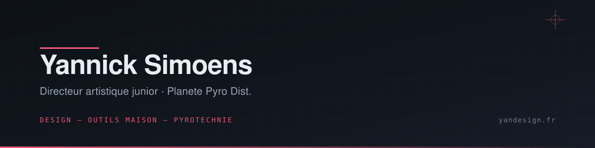

## Hey , I'm [Yannick!](https://yandesign.fr) 

   

        <!-- Organisation  -->
        <samp>
                「 Directeur artistique junior @ Planete Pyro Dist. 」
                 
                「 Freelance & outils maison : <a href="https://yandesign.fr" target="_blank">yandesign.fr</a> 」
                 
                 
        </samp>
        <!-- Code logo -->
        
        <!-- TypeScript -->
        
        <!-- Python -->
        
        <!-- Go -->
        
        <!-- Rust -->
        
        <!-- Swift -->
        
        <!-- Svelte -->
        

## ⚡ Technologies

  

- 🔭 Je bosse sur des outils internes : plans de tir pyrotechniques, bibliothèques documentaires, agents IA en CLI
- 🌱 J'apprends en permanence — Rust, Swift, et tout ce qui traîne dans mon `~/bin`
- 🎨 Le design d'abord, le code ensuite ; le contraire ne marche jamais

<h3>🧩 &nbsp; Ce que je construis</h3>

- **Pyrotechnie** — plans de tir, calculs de distances de sécurité, durées, PMA, export PDF
- **Outils internes Planete Pyro Dist.** — bibliothèque documentaire self-hosted, intranet/extranet, découpe automatisée de rushes produits (Python + FFmpeg)
- **Agents IA & CLI** — boucles d'agent, serveurs MCP (OCR Mistral), pipelines de dev assistés
- **Web & identité** — cartes de visite NFC, chartes graphiques, portfolios

        
        

<!--
  Stats GitHub — volontairement masquées (repos quasi tous privés : 0 star, streak 0).
  Décommenter ce bloc pour les réafficher.

  

  

-->

