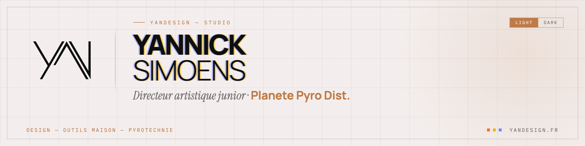

  <picture>
    <source media="(prefers-color-scheme: dark)" srcset="assets/hero-dark.png">
    
  </picture>

  

<h3><samp>01 — IDENTITÉ</samp></h3>

|  |  |
|:--|:--|
| <samp>Poste</samp> | Directeur artistique junior |
| <samp>Studio</samp> | **Planete Pyro Dist.** |
| <samp>Indépendant</samp> | [yandesign.fr](https://yandesign.fr) — communication digitale & branding |
| <samp>Approche</samp> | le design d'abord, le code ensuite |
| <samp>Base</samp> | France |

<h3><samp>02 — STACK</samp></h3>

  
  
  
  
  

  
  
  
  
  
  

  
  
  
  
  
  

<h3><samp>03 — CE QUE JE CONSTRUIS</samp></h3>

|  |  |
|:--|:--|
| <samp>Pyrotechnie</samp> | plans de tir, calculs de distances de sécurité, durées, PMA, export PDF |
| <samp>Outils internes</samp> | bibliothèque documentaire self-hosted, intranet/extranet, découpe automatisée de rushes produits (Python + FFmpeg) |
| <samp>Agents IA & CLI</samp> | boucles d'agent, serveurs MCP (OCR Mistral), pipelines de dev assistés |
| <samp>Web & identité</samp> | cartes de visite NFC, chartes graphiques, portfolios |

<h3><samp>04 — CONTACT</samp></h3>

  
  

  <samp>Design — outils maison — pyrotechnie</samp>
    
  

<!--
  Stats GitHub — volontairement masquées (repos quasi tous privés : 0 star, streak 0).
  Décommenter ce bloc pour les réafficher.

  

  

-->
